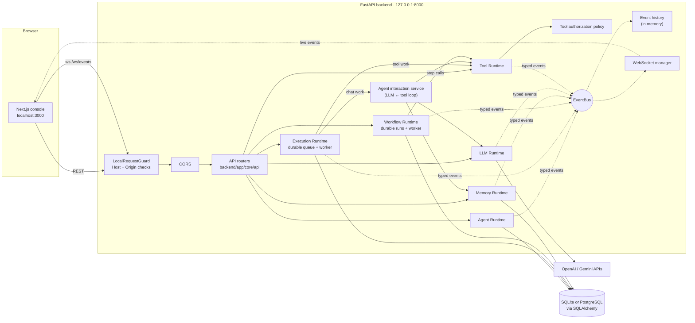
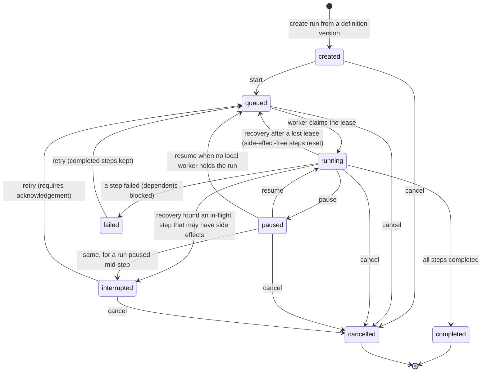
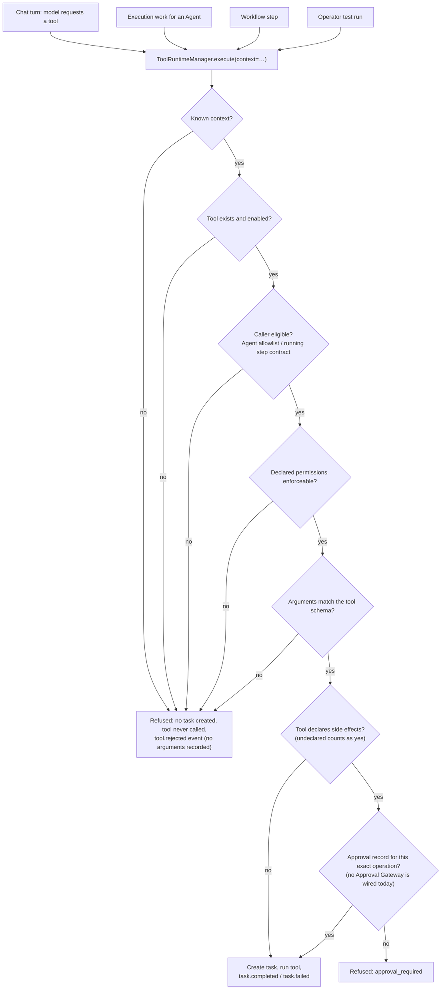

# Genesis

**An Agent Operating System: one platform for Agents, model calls, controlled tool execution, memory, durable workflows and runtime observability.**

> Simple on the surface, powerful underneath.

Genesis is in **active development** and is meant to run **locally, for a single operator**. It has no authentication, so do not expose it to a network (see [Security](#security)).

---

## Contents

- [Overview](#overview)
- [Current capabilities](#current-capabilities)
- [Architecture](#architecture)
- [Repository structure](#repository-structure)
- [Technology stack](#technology-stack)
- [Prerequisites](#prerequisites)
- [Local setup](#local-setup)
- [Running Genesis](#running-genesis)
- [Configuration reference](#configuration-reference)
- [Application routes](#application-routes)
- [How the main flows work](#how-the-main-flows-work)
- [Tool authorization and safety model](#tool-authorization-and-safety-model)
- [Database, migrations and persistence](#database-migrations-and-persistence)
- [Testing and development workflow](#testing-and-development-workflow)
- [Current limitations](#current-limitations)
- [Roadmap](#roadmap)
- [Troubleshooting](#troubleshooting)
- [Security](#security)
- [Further documentation](#further-documentation)
- [License](#license)

---

## Overview

**What Genesis is.** A modular backend and a web console for running AI Agents as long-lived actors. An Agent has an identity, a model, instructions, a list of tools it may use, conversations and memories. Around it, Genesis provides the runtimes that make Agent work reliable and inspectable: an execution runtime with durable, recoverable work; a tool runtime that only runs a tool after a server-side authorization decision; a workflow runtime for multi-step, dependency-aware jobs; a provider-neutral LLM runtime; and an event stream that feeds the console in real time.

**The problem it addresses.** A chat interface wired to a model and a few functions works until you need to know what ran, why, with which inputs, whether it is safe to retry, and what happens when the process stops halfway. Genesis treats those as platform concerns rather than per-feature code.

**How it differs from a chat wrapper.**

- A model's tool request is a *request*, not permission. Every tool call goes through one server-side policy that checks the tool, the caller, the arguments and whether approval is required, before the tool can run.
- Chat turns, tool work and workflow runs are durable records with lifecycle states, checkpoints and crash recovery. Work that may have had an external effect is never silently re-run.
- Each runtime is a separate module with its own domain model, and the runtimes communicate through typed events. The console reads the same APIs and event stream any other client would.

**Stage.** The core runtimes, persistence, recovery, the tool-authorization policy and the redesigned console are implemented and tested. Authentication, a human approval workflow, multi-Agent coordination and plugin isolation are **not** implemented yet; see [Current limitations](#current-limitations) and [Roadmap](#roadmap).

---

## Current capabilities

| Area | Implemented today | Notable limits |
|---|---|---|
| **Agents** | Create, configure (model, instructions, allowed tools), initialize, stop, delete. Directory with search and status. Multi-session conversations. | No authentication; any local client can manage any Agent. |
| **Conversations** | Each message runs as a durable execution. The model may call tools, up to 5 rounds per turn. Replies render safe Markdown; failed turns show their reason and can be retried. | No streaming responses. |
| **Tool execution** | Built-in tools: `echo`, `calculator`, `uuid`, `random_number`, `delay`. One authorization policy for every caller, strict argument validation, and a bounded calculator. | Tools that declare side effects are blocked until an Approval Gateway exists (none of the built-ins declare them). |
| **Memory** | Agent-scoped records (fact, note, preference, context) with tags. Create, edit, delete and search, persisted in the database. The newest memories are added to each conversation's context. | Search is case-insensitive substring matching, not semantic search. |
| **Workflows** | Versioned definitions of tool steps with dependencies. Runs execute ready steps in parallel and can be started, paused, resumed, cancelled, retried and deleted. Crash recovery. | Steps call tools directly, with a workflow identity and no Agent. The console cannot edit or delete saved definitions. |
| **Model providers** | OpenAI and Google Gemini adapters behind one provider interface, with a manual test request from the console. | "Configured" means a key is present, not that requests succeed. |
| **Operations** | Executions with full state timelines, retry and cancel; recent events, logs and service health; a live event stream. | Events, logs and tool-run history are kept in memory and reset on restart. |
| **Console** | Next.js app shell with a sidebar, global Command Palette (⌘K / Ctrl+K), deep-linkable URLs, responsive layouts and accessible dialogs. | Single operator; no accounts. |
| **Local API protection** | Loopback-only `Host` check and an `Origin` check on state-changing requests and WebSocket handshakes. | Not authentication; see [Security](#security). |

---

## Architecture

### System overview

The frontend is a separate Next.js app that calls the FastAPI backend over REST and receives live updates over one WebSocket. All business logic lives in the backend's Core runtimes, which are wired together once at startup in `backend/app/main.py`.



### Core subsystems

All paths are under `backend/app/core/`.

| Subsystem | Path | Responsibility |
|---|---|---|
| API layer | `api/` | FastAPI routers (`routers/`), request and response schemas (`schemas/`), dependency resolution (`dependencies/`), and `local_request_guard.py` (Host and Origin checks). |
| Core services | `core_services/` | Settings (`config/`), structured logging, the service registry used for dependency injection, the async `event_bus.py`, and shared persistence helpers. |
| Runtime lifecycle | `runtime/` | Starts and stops registered services in order. |
| Agent Runtime | `agent_runtime/` | Agent identity and lifecycle (`agent_manager.py`, `agent_registry.py`), configuration, sessions, context assembly, the interaction loop (`agent_interaction_service.py`), chat as durable work (`chat_work.py`), and Agent tool grants (`tool_grants.py`). |
| Execution Runtime | `execution_runtime/` | Durable executions: queue, lease-based worker, state timeline, checkpoints, retry decisions and crash recovery. Routes work by kind (`chat`) or `tool_name`. |
| Tool Runtime | `tool_runtime/` | Tool contracts and built-ins (`domain/tool.py`), registry, executor, `ToolRuntimeManager` (the only entry point), `authorization_policy.py`, `argument_schema.py`, and execution contexts (`domain/authorization.py`). |
| Memory Runtime | `memory/` | Agent-scoped memory records behind a provider interface. The active provider is `SqlAlchemyMemoryProvider`. |
| Workflow Runtime | `workflow_runtime/` | Versioned definitions, runs, dependency-aware dispatch, pause, resume, cancel, retry and recovery. Implements the workflow step grant used by the tool policy. |
| LLM Runtime | `llm_runtime/` | Provider registry, provider-neutral request and response models, error classification, and the OpenAI and Gemini adapters (`infrastructure/`). |
| Observability | `observability/` | Typed event classes, bounded in-memory event history, the logger service (logs are published as events), and a heartbeat. |
| Realtime | `realtime/` | Forwards EventBus events to WebSocket clients on `/ws/events`. |
| Approval Gateway | `approval_gateway/` | **Contract only** (`domain/approval.py`). No gateway is implemented or wired, so operations that need approval are always blocked. |
| Legacy / scaffolding | `tool_manager/`, `workflow_engine/`, `plugin_system/`, `communication/`, `contracts/`, `core_services/auth/` | `tool_manager/` and `workflow_engine/` are earlier subsystems that are still instantiated but hold no tools or workflows, and no route runs them. `plugin_system/` is instantiated but loads no plugins. The other three are empty packages. |

### Design boundaries

- **Applications depend on Core, not the reverse.** The Core runtimes know nothing about the frontend or about `applications/`.
- **A model's tool request is not permission.** The model can only ask; `ToolRuntimeManager.execute` requires an explicit execution context and runs the policy before a task is created or the tool code runs.
- **Authority comes from the owning runtime.** The tool policy reads an Agent's allowed tools from the Agent registry and a workflow step's contract from the stored run. It never trusts what a caller claims about itself.
- **Workflows are not Agents.** Workflow steps run with a workflow context. They do not inherit an Agent's identity or allowlist.
- **The UI is not a security boundary.** Status badges, disabled buttons and permission labels in the console are informational; enforcement happens on the server.
- **Durable before effect.** A chat turn checkpoints before each tool call, and a workflow step is stored as running before its tool is called. Recovery can therefore tell what may already have happened.

---

## Repository structure

```text
Genesis/
├── backend/
│   ├── app/
│   │   ├── main.py                 # Composition root: wires every runtime, middleware and router
│   │   ├── core/                   # Core runtimes (see "Core subsystems")
│   │   │   ├── api/                #   routers/, schemas/, dependencies/, local_request_guard.py
│   │   │   ├── agent_runtime/      #   each runtime: domain/, application/, infrastructure/, tests/
│   │   │   ├── execution_runtime/
│   │   │   ├── tool_runtime/
│   │   │   ├── workflow_runtime/
│   │   │   ├── memory/
│   │   │   ├── llm_runtime/
│   │   │   ├── observability/
│   │   │   ├── realtime/
│   │   │   ├── approval_gateway/   #   contract only
│   │   │   └── core_services/      #   config, logging, DI registry, EventBus, persistence helpers
│   │   └── database/               # Engine, sessions, transactions, startup schema check
│   └── conftest.py                 # Test isolation: a fresh migrated SQLite database per test
├── infra/
│   └── migrations/                 # Alembic environment and versions/ (configured by alembic.ini)
├── frontend/                       # The Genesis console (Next.js, npm)
│   ├── app/                        # Routes: /, /agents, /memory, /workflows, /monitoring, /tools, /providers
│   ├── components/                 # ui/ (shared primitives), layout/ (shell, sidebar, command palette), feature folders
│   ├── hooks/                      # Data hooks (one realtime connection per page)
│   ├── lib/                        # Pure, unit-tested logic (status vocabulary, filters, commands, …)
│   ├── services/                   # Typed REST and WebSocket clients
│   ├── types/                      # API types
│   └── tests/                      # node --test unit tests
├── docs/                           # Design notes per subsystem (some predate the current code)
├── applications/product_manager/   # Placeholder for a future application built on Genesis (scaffold only)
├── packages/                       # py-shared/, ts-shared/: empty placeholders
├── tests/                          # contract/, integration/, e2e/: empty placeholders
├── .github/workflows/ci.yml        # Backend and frontend CI
├── pyproject.toml                  # Python package, dependencies, pytest configuration
├── alembic.ini                     # Alembic configuration
└── .env.example                    # Backend configuration template
```

The root `package.json` and `pnpm-workspace.yaml` describe a pnpm workspace over `applications/*/frontend` and `packages/ts-shared`, which are placeholders. **The working console is `frontend/` and uses npm** (`frontend/package-lock.json`).

---

## Technology stack

| Layer | Technology |
|---|---|
| Backend language | Python ≥ 3.12 |
| API | FastAPI, Uvicorn |
| Configuration | pydantic-settings (`.env` + environment variables) |
| Persistence | SQLAlchemy 2 (async), Alembic; SQLite (`aiosqlite`) or PostgreSQL (`asyncpg`) |
| Model SDKs | `openai`, `google-genai` |
| Backend tests | pytest, pytest-asyncio |
| Frontend | Next.js 16 (App Router), React 19, TypeScript 5 |
| Styling and motion | Tailwind CSS 4, Framer Motion, lucide-react icons, Geist fonts |
| Frontend tests and lint | Node's built-in test runner (`node --test`), ESLint 9 (`eslint-config-next`) |
| CI | GitHub Actions (Python 3.12, Node 22, PostgreSQL 16 service) |

---

## Prerequisites

- **Python 3.12 or newer**, with `venv`.
- **Node.js 22** (the version CI uses) and **npm**.
- **A database:** SQLite needs nothing extra. For PostgreSQL, you need a running server and an empty database.
- **Optional:** an OpenAI or Google Gemini API key, for Agents to call real models. Everything else works without one.

---

## Local setup

Commands run from the **repository root** unless they say otherwise. The examples use macOS or Linux shell syntax; Windows differences are noted where they matter.

### 1. Clone

```bash
git clone https://github.com/Yu-v-Raj/Genesis.git
cd Genesis
```

### 2. Create a virtual environment and install the backend

```bash
python3.12 -m venv .venv
source .venv/bin/activate        # Windows (PowerShell): .venv\Scripts\Activate.ps1
python -m pip install -e ".[dev]"
```

### 3. Create your configuration file

```bash
cp .env.example .env             # Windows: copy .env.example .env
```

`.env` is git-ignored. Keep it that way: it is where API keys go.

Then edit `.env`:

- **Database.** The template defaults to PostgreSQL. For the quickest start, switch to SQLite:

  ```env
  DATABASE_URL=sqlite+aiosqlite:///./genesis.db
  ```

  Relative SQLite paths resolve from the repository root, so the backend and Alembic use the same file. For PostgreSQL, create a database first (for example `createdb genesis`) and keep `DATABASE_URL=postgresql+asyncpg://localhost:5432/genesis`, adding credentials if your server needs them.
- **Model providers (optional).** Set `GEMINI_API_KEY` and/or `OPENAI_API_KEY`. Keys stay on the server and are never returned by the API.
- **`.env.example` notes.**
  - The template contains `HOST=0.0.0.0`, but the backend does not read `HOST` or `PORT`. The address comes from the `uvicorn` command in step 5, which binds to `127.0.0.1` by default.
  - Its comment about "any localhost port" in development is out of date; see [Configuration reference](#configuration-reference).

### 4. Create the database schema

```bash
alembic upgrade head
```

Run this again whenever you pull new migrations. The backend refuses to start, with an explanatory message, if the database is unreachable or not migrated to the current revision.

### 5. Start the backend

```bash
python -m uvicorn backend.app.main:app --reload
```

This listens on `http://127.0.0.1:8000`. Do not pass `--host 0.0.0.0`; see [Security](#security).

### 6. Install and start the frontend

From `frontend/`, in a second terminal:

```bash
cd frontend
npm ci
npm run dev
```

---

## Running Genesis

| What | URL |
|---|---|
| Console | `http://localhost:3000` |
| API documentation (Swagger UI) | `http://127.0.0.1:8000/docs` |
| Health check | `http://127.0.0.1:8000/health` (detailed: `/api/system/health`) |
| Event stream | `ws://127.0.0.1:8000/ws/events` |

**First run.**

1. Open **Providers** to see which providers have a key.
2. Open **Agents → Create Agent**, choose a model, allow the calculator, and ask *"Calculate 25 * 4"*. The reply shows the tool call that produced it. Each message is a durable execution, so **Operations** shows its full state timeline.
3. Open **Tools** and use **Test run** on a tool. This runs it as an operator test.

**Different ports.** If port 3000 is busy, Next.js moves to 3001, which the backend also accepts. For any other frontend port, add its exact origin to `CORS_ORIGINS` (see below) and restart the backend.

---

## Configuration reference

Backend settings come from environment variables and the root `.env` file (environment variables win), with the defaults below. They are defined in `backend/app/core/core_services/config/settings.py` and `constants.py`.

| Variable | Purpose | Default |
|---|---|---|
| `DATABASE_URL` | SQLAlchemy URL for SQLite (`sqlite+aiosqlite:///./genesis.db`) or PostgreSQL (`postgresql+asyncpg://…`). | `postgresql+asyncpg://localhost:5432/genesis` |
| `GEMINI_API_KEY` | Enables the Gemini provider. Optional. | unset |
| `GEMINI_MODEL` | Gemini model offered to Agents. | `gemini-3.6-flash` |
| `GEMINI_TIMEOUT_SECONDS` | Gemini request timeout. | `30` |
| `OPENAI_API_KEY` | Enables the OpenAI provider. Optional. | unset |
| `OPENAI_MODEL` | OpenAI model offered to Agents. | `gpt-4.1-mini` |
| `OPENAI_TIMEOUT_SECONDS` | OpenAI request timeout. | `30` |
| `ANTHROPIC_API_KEY` | Accepted by settings, but **no Anthropic provider exists**, so it has no effect. | unset |
| `CORS_ORIGINS` | JSON list of exact browser origins allowed to call the API. The same list is trusted for state-changing requests. | `["http://localhost:3000","http://127.0.0.1:3000","http://localhost:3001","http://127.0.0.1:3001"]` |
| `TRUSTED_HOSTS` | JSON list of `Host` names the backend answers (any port). | `["localhost","127.0.0.1","[::1]"]` |
| `WORKER_LEASE_SECONDS` | How long a worker's claim on an execution or workflow run lasts without renewal. | `30` |
| `WORKER_CONCURRENCY` | Executions or runs one process works on at once. | `4` |
| `AGENT_CONTEXT_MAX_TURNS` | Most recent complete conversation turns sent to the model. | `20` |
| `EVENT_HISTORY_SIZE` | Events (including logs) kept in memory for the API. | `1000` |
| `HEARTBEAT_INTERVAL_SECONDS` | Interval of the system heartbeat event. | `30` |
| `LOG_LEVEL` | Backend log level. | `INFO` |
| `ENVIRONMENT`, `APP_NAME`, `APP_VERSION`, `APP_DESCRIPTION` | Application metadata. | `development`, `Genesis`, `0.1.0`, … |
| `HOST`, `PORT` | Defined in settings but **not used** by any launch path. Use uvicorn's `--host` and `--port`. | `127.0.0.1`, `8000` |
| `GENESIS_TEST_POSTGRES_URL` | Tests only: a **disposable** PostgreSQL database for the persistence tests. It is reset for every test. | unset |

**Serving the frontend from another port.** Add the exact origin, for example `CORS_ORIGINS=["http://localhost:3000","http://localhost:5173"]`. Keep `TRUSTED_HOSTS` loopback-only. Opening the backend to other hosts is a network exposure, not a port change.

**Frontend API addresses (optional).** The console calls `http://127.0.0.1:8000` by default. You can override this with `NEXT_PUBLIC_*` variables in `frontend/.env.local`: `NEXT_PUBLIC_AGENT_API_BASE_URL`, `NEXT_PUBLIC_API_BASE_URL`, `NEXT_PUBLIC_EVENT_API_BASE_URL`, `NEXT_PUBLIC_EXECUTION_API_BASE_URL`, `NEXT_PUBLIC_LLM_API_BASE_URL`, `NEXT_PUBLIC_MEMORY_API_BASE_URL`, `NEXT_PUBLIC_TOOL_API_BASE_URL`, `NEXT_PUBLIC_WORKFLOW_API_BASE_URL`, `NEXT_PUBLIC_WORKFLOW_DEFINITION_API_BASE_URL` and `NEXT_PUBLIC_REALTIME_URL`. Never put secrets in `NEXT_PUBLIC_*` variables: they are shipped to the browser.

---

## Application routes

| Route | Purpose | URL state |
|---|---|---|
| `/` | **Overview**: system health, activity and shortcuts. | none |
| `/agents` | **Agents**: directory, creation, settings and the conversation workspace. | `?agent=` selected Agent, `?session=` conversation, `?create=1` opens the create form |
| `/memory` | **Memory**: records by Agent, with search, create, edit and delete. | `?agent=`, `?memory=` |
| `/workflows` | **Workflows**: definitions, runs, step progress and run controls. | `?tab=workflows\|runs`, `?workflow=`, `?run=`, `?create=1` |
| `/monitoring` | **Operations**: executions (with timeline, retry and cancel), events, logs and system services. | `?tab=executions\|events\|logs\|system`, `?execution=`, plus `status`, `agent`, `kind` and `q` filters |
| `/tools` | **Tools**: catalogue, details (inputs, which Agents may use each tool, restrictions), operator test runs and recent runs. | `?tool=`, `?tab=runs` |
| `/providers` | **Model providers**: configuration state, observed results and a manual test request. | none |

Any other path shows a not-found page inside the console.

**Command Palette.** Press **⌘K** on macOS or **Ctrl+K** elsewhere, or use the search button in the top bar.
- **Contents:** every page, plus Create Agent, Create workflow, and Collapse/Expand sidebar.
- **Keys:** arrow keys move, Enter opens, Esc closes.
- **Server calls:** the palette makes none. Its actions only navigate, open a form or change a local preference.

---

## How the main flows work

### Agent conversation

1. `POST /api/agents/{id}/chat` checks that the Agent is idle and has a model.
2. It queues a durable **execution** of kind `chat` and waits for it.
3. The execution worker runs the turn through the Agent interaction service:
   - **Context:** the Agent's instructions; up to 20 of its newest memories (within a 4,000-character budget); the last `AGENT_CONTEXT_MAX_TURNS` turns; and the new message.
   - **Model call:** the request goes to the LLM Runtime with the tools the Agent is allowed to use.
   - **Tool requests:** if the model asks for tools, each request is authorized (see below), the Agent's progress is checkpointed, the tool runs, and its result goes back to the model. This repeats for at most 5 rounds.
4. The completed turn is stored in the session atomically. A failed turn leaves the conversation unchanged and is listed with its reason and a **Retry** action.

If the process stops mid-turn, recovery checks the stored evidence. A turn proven to have finished is marked completed; anything else is marked **interrupted**. Retrying an interrupted turn needs explicit acknowledgement only if its checkpoint shows a side-effecting tool had started; otherwise it is an ordinary retry. Queued work that never started simply runs after the restart.

### Workflows

- **Definitions.** A definition is a named list of tool steps with dependencies. When it is saved, the server checks the dependency graph (no cycles or missing steps), that every tool exists, and that every step's arguments match its tool's schema. Updating a definition stores a new version (`PUT /api/workflow-definitions/{id}`, API only), and each run keeps the version it was created from.
- **Runs.** A worker claims a queued run under a lease and starts every step whose dependencies have completed. Independent steps run in parallel. A failed step fails the run and blocks the steps that depend on it.
- **Durability.** Each step is stored as running before its tool is called.
- **Recovery.** If a run's lease expires:
  - completed steps are kept;
  - in-flight steps of side-effect-free tools return to pending;
  - in-flight steps of tools that may have side effects become **interrupted**, and the run waits for a person.
- **Identity.** Steps run with a workflow context, not as an Agent.



### Memory

- **Storage.** Memories belong to one Agent and are stored in the database (the `agent_memories` table), so they survive restarts.
- **Records.** Each one has a kind (`fact`, `note`, `preference`, `context`), content, tags and metadata.
- **Search** (`GET /api/agents/{id}/memory/search`): a case-insensitive substring match over content, tags and metadata, within that Agent.
- **Use in conversations.** Memories reach the model as background context, never as instructions.
- **Ranking.** There is no relevance ranking or embedding search: the newest memories are used first.

### Model providers

- **Models.** `GET /api/llm/models` lists each provider's model with `configured: true` when its API key is set. That only means a key is present.
- **Status in the console.** The Providers page shows a provider as responding or failing only from recorded model calls since the backend started. **Send test request** makes one real call through `POST /api/llm/generate`.
- **Diagnosing failures.** Both adapters classify failures the same way:
  - a missing or rejected key, or a model the key can't use: **configuration** error (HTTP 503 from `/api/llm/generate`);
  - a rate limit or exhausted quota: **provider error** (HTTP 502);
  - no answer in time: **timeout** (HTTP 504).

  Look for `llm.failed` events in **Operations → Events** and for failed chat executions in **Operations → Executions**, which show the error category.

---

## Tool authorization and safety model

Every tool call, from any caller, enters through `ToolRuntimeManager.execute(tool_name, arguments, context=…)`. The `context` keyword is required and names the caller:

| Entry point | Context | What the caller may run |
|---|---|---|
| The model requests a tool during a chat turn | `AgentToolContext` | Tools in that Agent's current `allowed_tools`, while the Agent is idle or running. |
| Execution work for an Agent (`POST /api/agents/{id}/execute` with `tool_name`) | `AgentToolContext` | Same rule as above. |
| A workflow step | `WorkflowToolContext` | Exactly the tool and arguments stored for that step, only while the step is running in the current attempt (compared as canonical JSON). |
| A test run from the Tools page (`POST /api/tools/execute`) | `OperatorTestContext` | Any enabled tool that passes the policy. This carries no identity and does **not** apply any Agent's allowlist. It cannot attach to an execution or claim an Agent or workflow identity. |



**Details that matter:**

- **Refusals leave no task.** A refused call never creates a task and never reaches the tool. Refusals carry a stable reason code and outcome (`unavailable`, `not_allowed`, `invalid_request`, `approval_required`).
- **Argument validation is closed by default.**
  - Supported: types (`object`, `string`, `integer`, `number`, `boolean`, `array`), `properties`, `required`, `additionalProperties`, `items`, `minimum` and `maximum`.
  - Undeclared arguments are rejected unless the schema allows them, and numbers must be finite.
  - Any other JSON Schema keyword (`enum`, `pattern`, `format`, …) is unsupported. A tool that uses one is refused **at registration**, so it never looks usable.
- **Permissions.** The only permission that can be enforced is `none`. A tool declaring anything else, or an empty list, cannot run.
- **Calculator limits.** It refuses expressions over 200 characters or 64 nodes, and results over 4,096 bits, before computing them. This keeps one request from blocking the server.
- **Caller metadata cannot impersonate.** Metadata a caller supplies is stored under `caller_metadata`. The server writes every identity and approval field itself.
- **Limit of the policy.** It governs entry points into the Tool Runtime. It does **not** isolate tool code from the backend process or from other code running in it.

---

## Database, migrations and persistence

- **Engines.** SQLite and PostgreSQL. CI runs the persistence tests and every migration on both.
- **Migrations.** Managed by Alembic (`alembic.ini`, `infra/migrations/versions/`; current head `0004`). Apply them with `alembic upgrade head`. `alembic check` reports drift between the models and the migrations.
- **Startup check.** The backend verifies that the database is reachable and at the expected revision before serving.

| Data | Storage | Survives a restart? |
|---|---|---|
| Agents, configuration, sessions and messages | Database | Yes |
| Executions, their state timelines and checkpoints | Database | Yes; interrupted work is recovered as described above |
| Workflow definitions (all versions), runs and steps | Database | Yes |
| Memories | Database | Yes |
| Tool run history (`/api/tools/history`) | In memory, last 1,000 tasks | No |
| Events and logs (`/api/events`, `/api/logs`) | In memory, last `EVENT_HISTORY_SIZE` events | No |
| A chat reply being generated | In memory | No; the execution becomes interrupted or retryable |

Tests never touch `DATABASE_URL`. `backend/conftest.py` gives each test its own freshly migrated SQLite database.

---

## Testing and development workflow

From the **repository root** (with the virtual environment active):

```bash
python -m pytest backend -q                                      # full backend suite
python -m pytest backend/app/core/tool_runtime -q                # one subsystem
python -m pytest backend/app/core/api/tests/test_local_request_guard.py -q
alembic check                                                    # models and migrations agree
python -m compileall -q backend infra                            # syntax check (as in CI)
```

To also run the persistence and recovery tests against PostgreSQL, set `GENESIS_TEST_POSTGRES_URL` to a **disposable** database before running pytest. It is wiped for every test.

From `frontend/`:

```bash
npm test                 # unit tests (node --test)
npx tsc --noEmit -p .    # type check
npm run lint             # ESLint
npm run build            # production build
```

GitHub Actions (`.github/workflows/ci.yml`) runs all of the above on every push and pull request to `main`:
- backend tests on SQLite and PostgreSQL 16;
- migrations upgraded, drift-checked and downgraded on both engines;
- frontend tests, types, lint and build.

CI needs no model API keys, because tests use deterministic fake providers.

`pyproject.toml` also contains Ruff and mypy configuration, but neither tool is a declared dependency and CI does not run them. Install them separately if you want to use them.

**Contribution checklist:**

- Follow the existing structure: domain, application and infrastructure inside each runtime, wired in `main.py`. Core must not import from applications.
- Add regression tests with every change to runtime behavior, especially execution, recovery and authorization.
- Keep the invariants: every tool call passes an explicit context through `ToolRuntimeManager.execute`; authorization stays on the server; tools declare complete, supported schemas.
- Don't log or emit secrets, credentials or raw tool arguments in events.
- Never commit `.env` or any file containing keys.
- Run the backend suite, the frontend checks and `git diff --check` before committing.

---

## Current limitations

These are true of the code today:

- **No authentication, accounts or roles.** Nothing identifies who makes a request, so nothing can be restricted per user.
- **No approval workflow.** The Approval Gateway is only a contract, and no human approval interface exists. Tools that declare side effects are therefore blocked everywhere.
- **Workflow steps have no Agent identity.** They don't inherit an Agent's permissions, and a workflow has no permission scope of its own beyond its stored steps.
- **Workflow runs are not Executions.** They appear on the Workflows page, not in the Operations execution list.
- **Some history is not durable.** Event, log and tool-run history live in memory and reset on restart.
- **Partial definition management.** Saved workflow definitions can be versioned through the API but not edited in the console, and they cannot be deleted.
- **A subset of JSON Schema.** Tool schemas support only the subset described above.
- **Tools run in the backend process.** They run on its event loop with no isolation or time limit; only the calculator has computational bounds.
- **Not built yet:** memory relevance ranking, streaming replies, multi-process deployment, multi-Agent coordination, planning and plugins.
- **Unverified integer handling.** Model providers' handling of whole-number arguments, such as `4` versus `4.0`, has not been checked against live APIs. Integer parameters accept only true integers.

---

## Roadmap

Implemented foundations:
- core runtimes, persistence and migrations;
- durable executions and workflows with crash recovery;
- chat as durable work;
- memories in context;
- CI;
- the redesigned console;
- **Milestone 1: Centralized Tool Authorization & Execution Safety.** One policy for every tool call, explicit execution contexts, strict argument validation, schema checks at registration, a bounded calculator, and local Host and Origin protection.

Planned, in order (no dates):

| Milestone | Scope |
|---|---|
| 2. Approval Gateway | Durable approval decisions tied to the exact operation, who can approve, expiry, and safely resuming approved work. Needs an operator-identity decision first. |
| 3. Durable execution and unified observability | Workflow runs as first-class executions, durable event and tool history, correlation and diagnosis. |
| 4. Authoritative tool contracts and workflow management | Backend tool schemas served to clients; editing and deleting definitions; migration of versioned definitions. |
| 5. LLM runtime reliability | Consistent error classification, timeouts, safe retries, rate limits and fallbacks. |
| 6. Higher-level Agent capabilities | Planning and multi-step work, then multi-Agent coordination once the lower layers are reliable. |
| 7. Release hardening | Security and reliability review, restart and capacity tests, deployment validation and documentation. |

---

## Troubleshooting

| Symptom | Likely cause and fix |
|---|---|
| Backend exits at startup mentioning the database | The database is unreachable or not migrated. Check `DATABASE_URL` (an exported variable overrides `.env`), then run `alembic upgrade head`. |
| `400 Untrusted Host header.` | You called the API through a hostname other than `localhost`, `127.0.0.1` or `[::1]`. Use one of those. |
| `403 Requests from this origin are not allowed.` | A browser page whose origin isn't in `CORS_ORIGINS` tried to change state. If it is your own frontend on another port, add its exact origin and restart. |
| Console shows "Can't reach Genesis" or empty data | The backend is not running on `127.0.0.1:8000`, or the frontend's `NEXT_PUBLIC_*` addresses point elsewhere. |
| A model shows "Configured" but chats fail | A key is present but requests fail. Use **Send test request** on Providers and look for `llm.failed` events in Operations. Common causes: an invalid key, quota, or a model name the account can't use. |
| A tool call is refused | Check the reason in the response or the `tool.rejected` event: the tool isn't in the Agent's allowed tools, the arguments don't match its schema, or the tool needs approval. |
| A run or execution is **interrupted** | Genesis stopped while work that may have had external effects was in flight. Retry it (with acknowledgement) or cancel it. |

---

## Security

> **⚠️ Do not expose Genesis to a LAN or the internet.** It has no authentication. Before any non-local use, it needs a separate security review, authentication and authorization, and deployment hardening.

What protects a local installation today:

- **Loopback binding.** The documented command listens on `127.0.0.1` only.
- **Host check.** The backend refuses any `Host` header that isn't a trusted loopback name. This defeats DNS-rebinding attacks from websites.
- **Origin check.** Browser requests that change state (POST, PUT, PATCH, DELETE) and WebSocket connections are refused unless their `Origin` is a configured frontend origin or the backend itself. CORS additionally stops other sites from reading responses.
- **Tool authorization.** The policy described above, enforced on the server for every caller.
- **Server-side secrets.** API keys stay in the backend's environment and are never returned by the API.

What this does **not** do:

- **No identity.** It is not authentication. Requests without an `Origin` header, such as curl, scripts or any program on this machine, are accepted, and anything that can reach the port can read data through GET requests.
- **No process isolation.** It does not protect against hostile code already running on the machine or inside the backend process.
- **Data reaches providers.** Conversation content and memories are sent to whichever model provider an Agent uses.

---

## Further documentation

`docs/` contains design notes for each subsystem, for example `16-Tool-Runtime.md`, `18-Workflow-Runtime.md`, `20-Agent-Persistence.md` and `21-Durable-Executions-and-Workflows.md`. Several notes predate later changes. Where they disagree with this README or the code, the code and its tests are authoritative.

---

## License

The repository does not include a license file, and `package.json` declares the project `UNLICENSED`. No license is granted until one is added.
